# MegaCD-Snatcher-Kr — v0.9 시험판

메가 CD 미국판 *Snatcher*의 한국어 패치입니다. 게임 속 문구·선택문뿐 아니라 **음성에 맞춰 표시되는 한국어 자막**을 중점적으로 다룹니다. 자막은 게임의 페이지 넘김과 별도로 음성 진행을 따르도록 만든 **전용 Genesis Plus GX 코어**에서 그립니다. 화면 아래쪽의 흰 글자·검은 테두리 방식이며, 별도의 큰 검은 자막 상자를 만드는 방식이 아닙니다.

> **중요: 일반 Genesis Plus GX 코어만으로는 보이스 자막이 나오지 않습니다.** 이 배포판과 짝을 이루는 개조 코어를 반드시 사용하세요. 게임 BIN만 패치한 뒤 기본 코어에서 실행하는 것은 지원하는 완성 구성으로 간주하지 않습니다.

이 저장소와 배포 파일에는 원본 게임 이미지, 패치 완료된 전체 게임 이미지, BIOS, RetroArch APK가 없습니다. 본인이 보유한 정확한 미국판 BIN과 별도 BIOS가 필요합니다. 비공식·비상업적 팬 프로젝트이며 Konami, Sega, Libretro와 제휴하지 않았습니다. **v0.9는 시험판**입니다. 이번에는 메탈기어의 존댓말 혼용과 ACT 2 국장 회상 설명의 말투·호칭을 교정했습니다. 전체 등장인물의 문맥 재검수 완료나 전편 모든 분기 플레이·모든 기기의 동작 보증을 뜻하지 않습니다.

## Nintendo DS(NDS) 포팅 버전

[**DS-Snatcher-Kr-MegaCD-Porting — GitHub**](https://github.com/OldManCraveGuitars-bit/DS-Snatcher-Kr-MegaCD-Porting)는 이 한글패치의 번역·보이스 자막을 바탕으로 만든 **Nintendo DS용 비공식 이식 프로젝트**입니다. 상단에는 게임 장면, 하단에는 한국어 대사·초상화·선택지와 터치 조작을 배치했습니다.

현재 [NDS v0.811](https://github.com/OldManCraveGuitars-bit/DS-Snatcher-Kr-MegaCD-Porting/releases/tag/v0.811)은 **Mega-CD v0.81 자료 기반의 전체 테스트용 버전**이며, 이번 v0.9 교정이 자동으로 포함된 것은 아닙니다. 버그·미검증 구간이 남아 있습니다. 이 저장소의 DLL/SO 대신 **NDS 저장소의 별도 패처와 실행 안내**를 이용하세요. 사용자 소유 원본 게임과 지원 BIOS가 필요하며 완성 NDS는 배포하지 않습니다.

## v0.9 변경 사항

- **메탈기어 본문 4곳·보이스 자막 22개**의 반말 혼용을 존댓말로 교정했습니다. 예: `병원 복도야` → `병원 복도입니다`, `그건 수사 경비인데` → `그건 수사 경비인데요`. 인접한 길리언의 응답은 그대로 두었습니다.
- **ACT 2 회상 전체 55문구**를 원문과 대조하고 국장 설명 **27문구**의 말투·호칭을 교정했습니다. `두 분은 … 향했습니다` → `자네와 메탈은 … 향했지`, 두 군데의 `당신이 … 처치했습니다` → `자네가 … 처치했지`. 처치 주체인 길리언과 원문 의미는 유지합니다.
- 국장 본문 336개와 관련 보이스 장면 138등록도 대조했습니다. 138개에는 다른 인물의 응답이 포함됩니다. 메탈의 보고·길리언이 국장에게 말하는 존댓말까지 일괄 변환하지 않았습니다.
- 기존 음성·오프닝과 모든 자막 시작·페이지 전환·종료 시각은 유지합니다. 회상은 **75쪽의 시간표를 그대로** 사용하며, 자막은 **하단 흰 글씨·검은 테두리**입니다. 렌더러와 음성 동기 처리 코드는 바꾸지 않았습니다.
- **Windows·Android·Linux 전용 코어를 모두 r52로 갱신**했습니다. **미국판 원본에서 게임을 다시 패치하고, 전용 코어도 반드시 함께 교체하세요.** 구 r50 코어에는 이번 수정 보이스 자막이 없습니다. RetroArch 본체/APK는 수정하지 않습니다.
- v0.81의 `나폴레옹(NAPOLEON)`·`백일천하(100 day REIGN)`·`끝났다. (IS ENDED)`, 기존 깁슨·카트리나 영문 힌트, `위로하기`, 재채기 `에.. 에취!`, 미카 존댓말, `접수처` 교정도 유지합니다.

[이번 수정·확인 기록](docs/RELEASE-v0.9.md) · [v0.81 나폴레옹 힌트](docs/RELEASE-v0.81.md) · [v0.8 소개·힌트](docs/RELEASE-v0.8.md) · [v0.778 재채기](docs/RELEASE-v0.778.md) · [v0.777 미카 존댓말](docs/RELEASE-v0.777.md)

## 화면 예시

### v0.77에서 복원한 첫 폐허 이동 독백

아래 네 장은 **v0.77의 r251 게임 + r47 코어**에서 실제로 표시된 자막입니다. 이 네 문장의 문구·타이밍은 v0.775에서도 유지했습니다. v0.775에서 새로 촬영한 화면은 아닙니다. 새게임으로 만든 동일 제품 체크포인트에서 정상 메뉴로 진행했으며, 장면·게임 메모리를 강제로 바꾸지 않았습니다. 같은 실행의 원본 해상도 캡처를 확대했습니다. 녹화 음성과 원음의 네 지점을 대조해 독백 구간의 정상 재생 속도를 확인했고, 자막 전후에는 글자가 사라지는 것도 확인했습니다.

| 첫 문장 | 깁슨의 추적 |
| --- | --- |
| 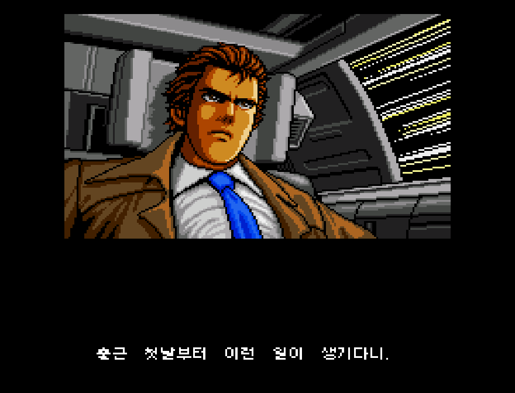 | 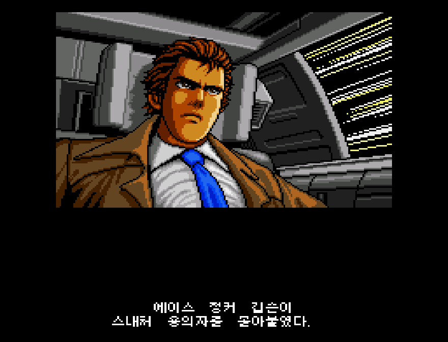 |
| 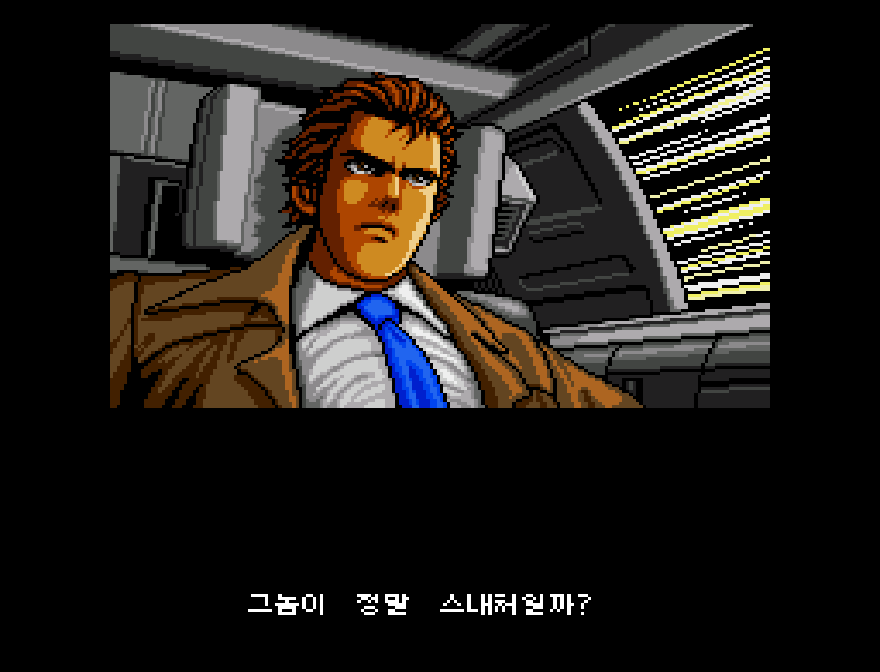 | 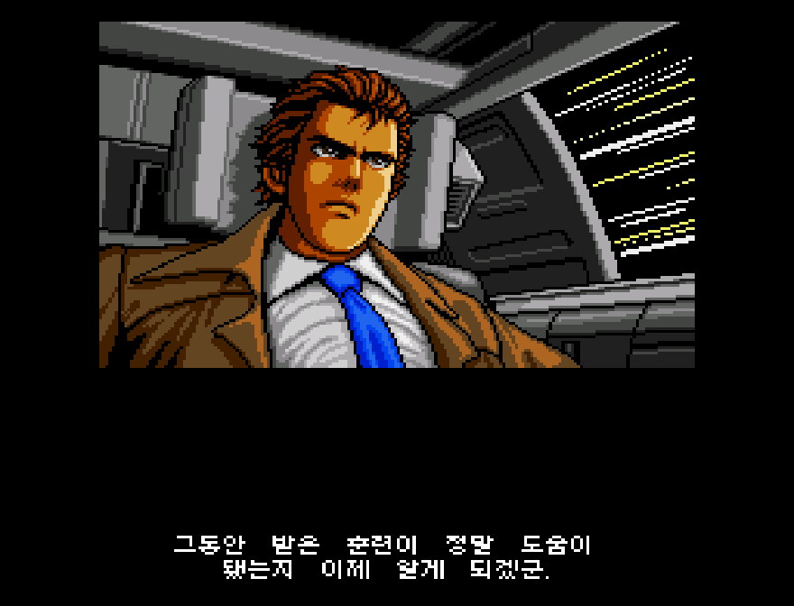 |

### 기존 장면

| 화면 | 설명 |
| --- | --- |
| 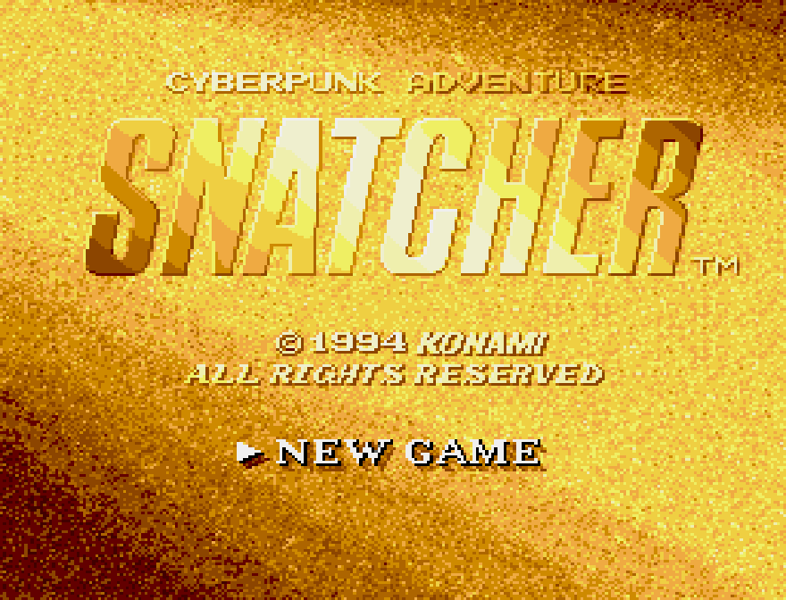 | r249 게임의 타이틀. 원작의 타이틀 연출은 유지됩니다. |
| 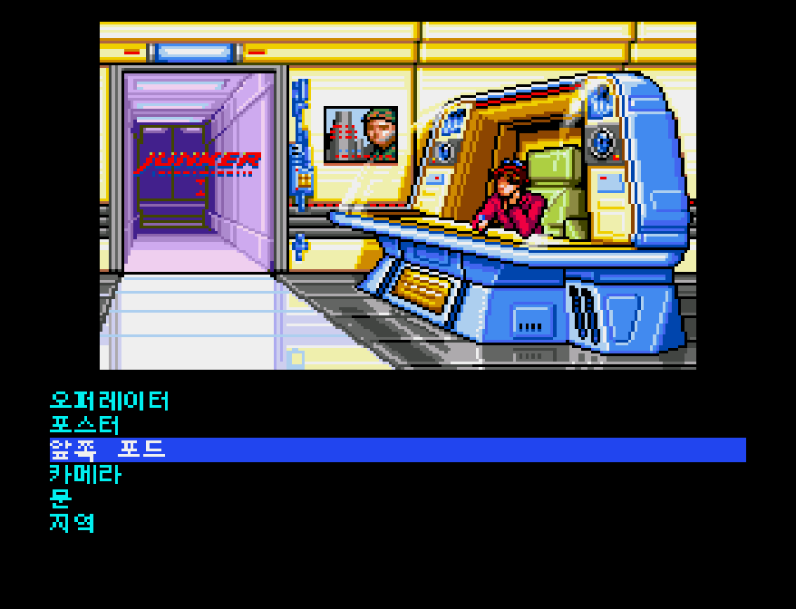 | 개발 중 확인한 한국어 명령 메뉴 예시(r38 캡처). |
| 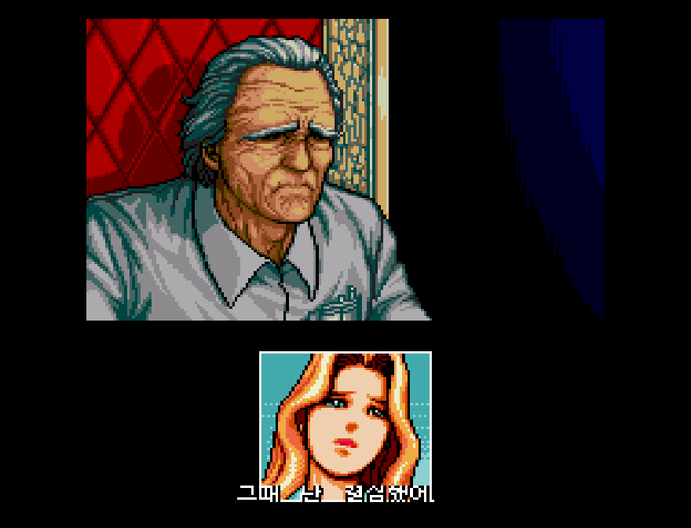 | r249 게임 + r44 전용 코어에서 음성 진행에 따라 나타난 한국어 자막. 초상화와 자막이 같은 하단 영역을 공유할 수 있습니다. |
| 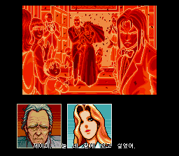 | r249/r44에서 캡처한 복수 초상화 장면의 한국어 자막 예시. |

스크린샷은 실제 개발·검증 실행의 정지 화면이며, 서로 다른 시점의 캡처를 함께 보여줍니다. 한 장의 그림만으로 모든 장면의 표시 품질이나 타이밍을 보증하지 않습니다.

### 오프닝 장면 더 보기

오프닝의 초반 문구부터 내레이션·사이보그 연출까지 **12장**을 [오프닝 갤러리](docs/OPENING-GALLERY.md)에 추가했습니다. 아래 미리보기는 v0.75 직전 r248/r43의 정상 속도 녹화에서 추출한 실제 프레임입니다. v0.75와 픽셀·자막 시점이 완전히 동일하다는 주장은 아닙니다.

| 초반 문구 | 한국어 헌정 문구 | 내레이션 장면 | 후반 연출 |
| --- | --- | --- | --- |
|  | 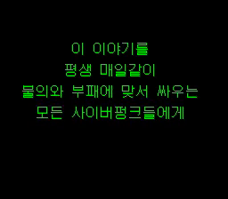 | 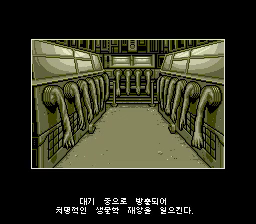 | 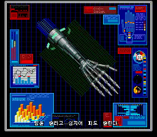 |

## 받기 전에 확인할 것

1. [v0.9 릴리스](https://github.com/OldManCraveGuitars-bit/MegaCD-Snatcher-Kr/releases/tag/v0.9)에서 `SnatcherKRInstaller.exe` 또는 같은 EXE가 든 ZIP을 받습니다. **Windows 64비트용 패처**이며 APK 생성기나 RetroArch 수정 도구가 아닙니다.
2. 본인이 보유한 미국판 원본 `Snatcher (USA).bin`을 준비합니다. 파일 크기 **625,192,176바이트**, SHA-256 **`8d6f4dba8d9ce59991be9f65635047adc3b0f37ea2358f8c48b251883c9e55b6`**, CRC32 **`3faf807d`**만 입력으로 받습니다. 다른 덤프·다른 리전·이미 수정된 BIN은 거부합니다.
3. 결과를 넣을 **이미 존재하는 빈 폴더**를 준비합니다. 약 **700MB 이상**의 여유 공간이 필요합니다. 패처는 동명 파일을 덮어쓰지 않습니다.

## 패처 사용법

1. ZIP으로 받았다면 압축을 풀고 `SnatcherKRInstaller.exe`를 실행합니다. Windows 보안 경고가 뜨면 발행자와 [아래 SHA-256](#sha-256-검증)을 확인한 뒤 본인이 실행 여부를 판단하세요.
2. **원본 BIN 선택**에서 위의 `Snatcher (USA).bin`을 지정합니다. 패처가 크기·SHA-256·CRC32를 확인합니다.
3. **결과 폴더 선택**에서 빈 폴더를 지정하고 설치를 누릅니다. 패처가 BPS를 적용한 뒤 출력 BIN과 동봉 파일의 해시를 확인합니다. 실패하면 원본 BIN은 바뀌지 않습니다.
4. 결과 폴더에서 `Snatcher-KR-v0.9.bin`과 `Snatcher-KR-v0.9.cue`를 **함께 보관**합니다. RetroArch에서 게임을 열 때는 **`.bin`이 아니라 `.cue`**를 선택하세요. 이렇게 해야 CD 오디오 트랙 참조를 유지할 수 있습니다.
5. 사용하는 플랫폼에 맞는 **전용 코어**를 설치·선택하고 게임 `.cue`를 엽니다. 일반 코어로 열면 한국어 보이스 자막 기능이 빠집니다. BIOS는 RetroArch 안내에 따라 사용자가 별도로 설정해야 합니다.

### 플랫폼별 코어

| 플랫폼 | 전용 코어 파일 | 상태 |
| --- | --- | --- |
| Windows x86_64 | `genesis_plus_gx_snatcher_kr_libretro.dll` | r52. DLL 로드와 수정 자막 포함, 패처 실제 적용 후 출력 해시를 확인했습니다. 이번 교정판의 새 전편 플레이 검증은 아닙니다. |
| Android ARM64 | `genesis_plus_gx_snatcher_kr_libretro_android.so` | 패처가 함께 출력합니다. APK는 수정하지 않습니다. 실제 Android 기기의 코어 로딩·게임 재생은 아직 미검증입니다. |
| Linux x86_64 | `genesis_plus_gx_snatcher_kr_libretro.so` | 패처가 함께 출력하고, 릴리스에서 단독으로도 받을 수 있습니다. Ubuntu 24.04 x86_64에서 빌드·ELF/의존성·동적 로드/libretro API 검사를 통과했습니다. 게임 재생은 미검증입니다. |

Windows에서는 출력된 DLL을 RetroArch의 사용자 코어 위치에 복사하거나 코어 파일을 직접 불러옵니다. Android에서는 출력된 ARM64 SO를 기기로 옮긴 뒤 기기 RetroArch에서 외부 코어 설치/가져오기 기능을 사용합니다. Linux에서는 Linux x86_64 SO와 같은 이름의 `.info`를 코어 및 코어 정보 위치에 두거나 해당 SO를 직접 불러옵니다. 버전·배포 방식에 따라 메뉴 이름과 코어 경로가 다를 수 있으므로 설치된 RetroArch의 안내를 확인하세요. Android용 SO를 Linux용으로, Linux용 SO를 Android용으로 바꿔 쓸 수는 없습니다.

패처는 게임 BIN/CUE, Windows DLL, Android ARM64 SO, Linux x86_64 SO, 코어 정보 `.info`, 코어·폰트 라이선스, 개조 코어의 전체 소스 ZIP과 빌드 기록을 한 폴더에 출력합니다. 원본 BIN, 기존 파일, RetroArch 설치본은 덮어쓰지 않습니다.

### Windows 없이 수동 적용하기

Linux/Android만 사용하는 사람을 위해 릴리스에 `Snatcher-KR-v0.9.bps`, 결과용 `Snatcher-KR-v0.9.cue`, 플랫폼별 전용 코어도 개별 자산으로 제공합니다. BPS 지원 패처에서 **위 해시의 원본 BIN → BPS → 새 결과 BIN** 순서로 적용하세요. 결과 BIN 이름을 `Snatcher-KR-v0.9.bin`으로 맞추고, 릴리스의 `Snatcher-KR-v0.9.cue`와 같은 폴더에 두세요. CUE 안의 `FILE` 지시문이 이 BIN을 가리킵니다. 결과 SHA-256이 아래 값과 일치해야 합니다. 이 경로에서는 v0.9의 r52 전용 코어도 별도로 받아야 하며, 원본·결과 게임 자체는 릴리스에 없습니다.

**v0.81 이하 사용자는 미국판 원본에서 v0.9로 다시 패치하고 전용 코어도 함께 교체하세요.** 이미 패치한 BIN에는 덧씌우지 않습니다. 기존 r50 코어를 재사용하면 수정 전 보이스 자막이 나옵니다. 새 CUE만 이전 이름의 BIN 옆에 섞으면 열리지 않습니다. 저장 파일은 먼저 백업하세요. 예전 세이브스테이트에는 수정 전 대사 데이터가 메모리에 남아 있을 수 있으므로, 게임을 완전히 다시 실행한 뒤 **게임 내 저장을 불러오고 해당 장소에 재진입**하는 방식을 권장합니다. 게임 파일명이 바뀌어 저장이 보이지 않으면 원래 저장 파일을 보존한 채 사용 중인 RetroArch의 저장 이름/경로 설정을 확인하세요. 모든 세이브스테이트 호환성을 보증하지는 않습니다.

## SHA-256 검증

아래 값은 **v0.9 게임·r52 코어** 기준입니다. 게임 BIN/BPS·패처와 전용 코어3종이 모두 갱신되었습니다. 해시가 다르면 파일·버전을 다시 확인하세요.

| 대상 | 크기(바이트) | SHA-256 | CRC32 |
| --- | ---: | --- | --- |
| 입력 원본 `Snatcher (USA).bin` | 625,192,176 | `8d6f4dba8d9ce59991be9f65635047adc3b0f37ea2358f8c48b251883c9e55b6` | `3faf807d` |
| 출력 한국어 v0.9 BIN | 625,192,176 | `2b168515e4fe61127d88b05144e719a98e7885298063693ad8a55044a6dc2e36` | `961958b0` |
| 내장 BPS 패치 | 1,120,059 | `1c392fcfa3e59033094febf2c7f9d0c7aac0f795d8c90d29c4de2e4fe4836b03` | `2144df1c` |
| 출력 Windows r52 DLL | 6,230,376 | `775a082a87147d206445d979eb5a97a5bea84fd01f40d46ec50e8dd3d09b2f75` | `9fe0abe5` |
| 출력 Android ARM64 r52 SO | 9,068,768 | `358aabf99c5e57ea1a8b74828be5611da94f7118404d59a378153acea6b58627` | `5e355d02` |
| 출력 Linux x86_64 r52 SO | 9,124,016 | `1239558c8462fc7835c61929421c4ebac67a05d0059fa4a6a2342bbd35bb42e5` | `f667d2d3` |
| 결과 CUE | 1,362 | `984ce76b7d421ac84c7f25521afd9e25b15f8d0368ff8b830feaebfc4dd1533a` | `ef265c20` |
| v0.9 패처 EXE | 34,778,814 | `fd4ce6639da75910c88d97bffced820834d56075309f95c5b0ce1c32f0704a4c` | `c0587e78` |

Windows PowerShell에서 수동 확인: `Get-FileHash -Algorithm SHA256 -LiteralPath '파일경로'`. Linux에서는 `sha256sum '파일경로'`를 사용할 수 있습니다. 파일명보다 **해시**를 우선하여 판별하세요. ZIP을 포함한 모든 배포 파일은 [SHA256SUMS-v0.9.txt](SHA256SUMS-v0.9.txt)에 기록합니다.

## 확인 범위와 알려진 제한

- 메탈기어 본문4/보이스22등록, 국장 회상27문구를 명시적 수정 목록과 대조했습니다. 국장 회상55문구 전부, 국장 본문336개·관련 보이스138등록을 읽은 범위와 수정한 범위를 구분해 기록했습니다.
- 최종 교정 관련 **자동시험96/96**, 배포 준비 단계 설치기·문구·편집기 관련 **57/57** 통과. 일부 시험이 겹치므로 합산한 독립 항목 수가 아닙니다. 본문4항목의 M68000 대사 읽기10구간도 확인했습니다.
- v0.81 대비 전체265,813섹터 중10섹터만 달라졌고, 나머지 섹터·ISO/CUE 구조와 수정 섹터 EDC/ECC를 확인했습니다. 기존 본문·폰트·퍼즐 힌트를 유지합니다.
- BPS 2회 생성 일치와 전체 적용 동작·CRC·목표 바이트 대조를 확인했습니다. **최종 배포 EXE의 원본 실적용 출력11/11** 해시·크기·CRC 일치, 원본 불변을 확인했습니다. GUI 관찰이나 전체 게임 플레이 시험과는 구분합니다.
- 실제 제품의 C 자막 소비·합성 코드를 분리 실행해 회상75/75쪽의 시작·끝, 정지/탐색/음소거, 흰 글씨·검정 윤곽과 글자 외 픽셀·게임RAM 불변을 확인했습니다. 회상 게임 장면 전체를 새로 재생한 검증은 아닙니다.
- 같은980소스에서 Windows·Android·Linux r52 코어를 준비하고 수정 그림 포함 여부를 3종 모두 대조했습니다. 기존 소스와의 차이는 자막 그림 헤더1파일이며 나머지979파일은 같습니다. [이번 Linux 빌드·ELF·동적로드/API1 기록](https://github.com/OldManCraveGuitars-bit/MegaCD-Snatcher-Kr/actions/runs/39643342748), 전체 소스·라이선스·빌드 기록을 제공합니다.
- **전체 등장인물의 전 대사 재검수 완료는 아닙니다.** 새 전편 청취·플레이·Android/Linux 실제 게임·실기 검증은 수행하지 않았습니다. 이미 해결한3인 초상화 반복 재생은 생략하고 기존 실제 화면을 촬영 버전과 함께 보존했습니다.
- 문제가 발생하면 화면, 플랫폼·코어 해시, 게임 BIN SHA-256, 장면과 재현 순서를 함께 알려 주세요. 게임/BIOS 파일은 첨부하지 마세요.

## 소스와 고지

전용 코어의 [완전한 개조 소스](core-source/modified-core-source.zip)와 [코어 라이선스](licenses/CORE-LICENSE.txt), [Galmuri 글꼴 라이선스](licenses/Galmuri-OFL-1.1.txt)를 제공합니다. 코어 소스에 관한 조건과 게임 원작의 권리는 서로 다릅니다. 이 저장소는 원작 게임에 대한 권리를 주장하지 않습니다. 게임·BIOS는 배포하지 않으며, 사용자 소유 원본에 적용하는 패치만 제공합니다.
