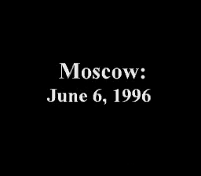
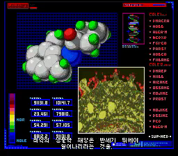
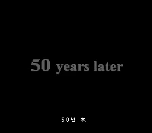
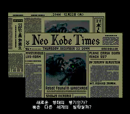
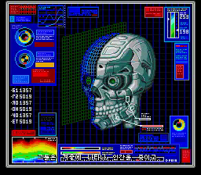
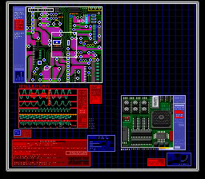
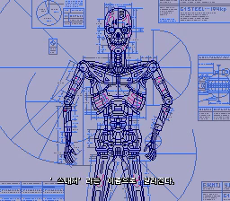
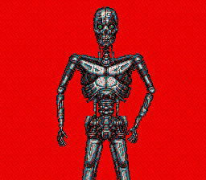

# 오프닝 스크린샷 갤러리

아래 12장은 r248 게임 + r43 전용 코어의 정상 속도 오프닝 녹화에서 원본 프레임을 추출한 **실제 화면**입니다. v0.75(r249/r44)보다 한 단계 앞선 개발판이므로, v0.75의 모든 픽셀·자막 시점이 이 그림과 같다고 보증하는 자료는 아닙니다. 원본 녹화 SHA-256은 `ecabe9204dba8b4b0532fe85a7be21f21ee83ffa7c0affaa71775888c1c6cec8`입니다. 아래 초 단위 표시는 녹화 시작점 기준입니다. 정지 화면은 음성과의 동기화를 증명하지 않습니다.

| 오프닝 초반 | 장면 |
| --- | --- |
|  | 10초 — 게임의 인물·장소·사건이 허구임을 알리는 한국어 문구. |
|  | 30초 — 녹색 헌정 문구가 순차적으로 나타나는 장면. |
|  | 40초 — 1996년 모스크바 날짜 화면. |
|  | 52초 — 복도 연출 아래 한국어 내레이션 자막. |
|  | 78초 — 분석 화면과 진행 중인 내레이션 자막. |
|  | 83초 — “50년 후” 전환 화면과 한국어 자막. |

| 오프닝 후반 | 장면 |
| --- | --- |
|  | 95초 — 사건을 전하는 신문과 한국어 내레이션. |
|  | 100초 — 사이보그 두개골 분석 연출과 자막. |
|  | 108초 — 기계 손 분석 연출과 자막. |
|  | 116초 — 회로 기판 연출. 자막이 없는 프레임도 포함해 화면 구성을 보여 줍니다. |
|  | 126초 — 전신 설계도 연출과 내레이션 자막. |
|  | 130초 — 붉은 배경의 사이보그 등장 장면. |

현재 릴리스의 다른 화면은 [README의 대표 스크린샷](../README.md#화면-예시)을 보세요. 이 갤러리는 장면 소개용이며 전편 검증이나 오프닝 타이밍 최종 승인 자료가 아닙니다.
