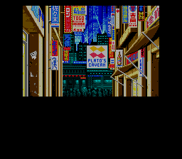
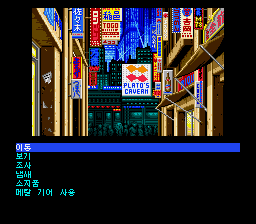
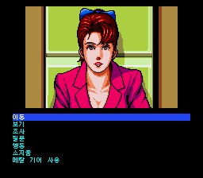
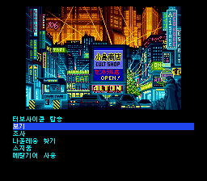
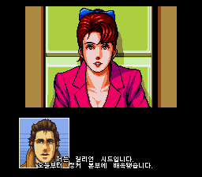

# 비공식 한글화 정식버전 V1.01 — ACT1 전환 정지 수정

**나폴레옹 등장 뒤 비디오폰을 종료하고 게임 화면으로 돌아올 때 멈추는 V1.0 문제를 수정했습니다.** 같은 방식으로 복귀하는 다른 장소와 본부 하차를 함께 확인했습니다. **보이스 자막에는 r61 전용 Genesis Plus GX 코어가 계속 필요합니다.**

## 변경 내용

- 공통 `SUBCODE.BIN`의 음성 시작 후크와 자막 호출 조건을 수정했습니다. 실제 PCM 음성 시작 때만 자막 등록을 처리하고, 게임의 대화 상태를 덮어쓰던 처리를 제거했습니다. 호출 전 CPU 상태도 보존합니다.
- 게임 이미지 전체 265,813섹터 중 **1섹터**만 달라집니다. 실행 코드 197바이트를 바꾸며, **모든 장소별 스크립트·번역·선택문·음원·글꼴·자막 그림과 시간표는 V1.0 그대로**입니다. 장소별 자막 기능을 끄는 우회판이 아닙니다.
- **Windows·Android·Linux r61 코어는 V1.0과 바이트 동일**합니다. 코어를 다시 개조하거나 RetroArch 본체/APK를 수정하지 않았습니다. [기술 기록](V1.01-TECHNICAL.md)

## 업데이트 방법

1. [V1.01 릴리스](https://github.com/OldManCraveGuitars-bit/MegaCD-Snatcher-Kr/releases/tag/v1.01)의 `SnatcherKRInstaller.exe` 또는 `MegaCD-Snatcher-Kr-v1.01-Windows-Patcher.zip`을 받습니다.
2. **미국판 원본 BIN**을 선택해 빈 폴더에 패치합니다. V1.0으로 패치된 BIN에 덧씌우는 방식이 아닙니다. Windows가 없으면 동봉 BPS와 CUE로 수동 적용할 수 있습니다. [자세한 사용법](../README.md#패처-사용법)
3. `Snatcher-KR-v1.01.bin`과 `Snatcher-KR-v1.01.cue`를 함께 보관하고 **CUE**를 실행합니다.
4. **V1.0 사용자는 기존 r61 전용 코어를 유지하면 됩니다.** v0.95 이하 사용자는 동봉 코어도 설치하세요. 기존 Vita 시험판 코어도 재다운로드할 필요가 없습니다. Linux 코어 자산은 **x86_64용**이며 Android ARM64 SO와 호환되지 않습니다.
5. 저장을 백업하고 게임을 완전히 종료·재실행한 뒤 **게임 내 저장**을 불러오세요. **옛 세이브스테이트에는 수정 전 실행 코드가 들어 있으므로 불러오지 마세요.** 이미 멈춘 장면의 상태 저장을 그대로 이어서는 수정이 적용되지 않습니다. 파일명 변경 후 저장이 안 보이면 기존 저장을 지우지 말고 RetroArch 저장 경로·이름을 확인하세요.

## 확인 범위

- 같은 게임 내 저장과 같은 메뉴 조작으로 **미국 원본은 정상, V1.0은 순정 GX/r61 모두 정지**하는 대조를 수행했습니다. V1.0은 SP11 통화 복귀 뒤 메뉴가 사라지고 3,600프레임 추가 대기와 입력에도 진행하지 않았습니다.
- 수정판의 표적 전환 **5/5 통과**: 플라톤 동굴 앞 나폴레옹 통화 종료 복귀, 본부 하차 후 접수처 메뉴, 아우터 헤븐 앞 비디오폰 복귀, 알톤 프라자 비디오폰 복귀, 닐슨 아파트 앞 비디오폰 복귀. 마지막 구간은 순정 GX로도 메뉴 복귀와 후속 입력을 확인했습니다.
- 새 게임 오프닝에서 본부까지 진행하고 실제 PCM 음성 자막 **3대사 연속 표시·종료 후 소거**를 확인했습니다. 기존 자막 문구·시간표·코어 파일을 수정하지 않았습니다.
- 공통 후크·자막 선택기 관련 기존 시험 **138/138**, 음성 후크 관련 시험 **32/32**, 후속 빌드에서 옛 코드가 재설치되지 않도록 하는 검사 등 **7/7** 통과. 시험 묶음에는 목적이 다른 검사가 포함되어 있으며 전편 실플레이 횟수가 아닙니다.
- BPS 두 번 생성 결과 일치, 원본→결과 전체 바이트/CRC 대조, **실제 최종 EXE 적용 결과 11/11 파일 해시 일치**, 원본 불변 및 패처 UI 시작 검사를 확인했습니다.
- 실행 확인은 **Windows에서 변경하지 않은 코어 DLL을 별도 libretro 진단 호스트로 실행**한 결과입니다. 게임 RAM 주입·강제 장면 로드 없이 정상 부팅과 게임 내 저장·메뉴 입력을 사용했습니다. 제보자의 Linux 장치, Android/Vita 실기 또는 전편 모든 분기를 새로 플레이한 결과는 아닙니다. Linux 장치에서 같은 수정 코드의 효과는 추가 확인이 필요합니다.

| V1.0: 통화 후 메뉴가 사라짐 | V1.01: 같은 구간 메뉴 복귀 |
| --- | --- |
|  |  |

| 본부 하차 | 알톤 프라자 복귀 | 보이스 자막 유지 |
| --- | --- | --- |
|  |  |  |

## 입력·출력 해시

| 대상 | 크기(바이트) | SHA-256 | CRC32 |
| --- | ---: | --- | --- |
| 입력 원본 BIN | 625,192,176 | `8d6f4dba8d9ce59991be9f65635047adc3b0f37ea2358f8c48b251883c9e55b6` | `3faf807d` |
| 출력 V1.01 BIN | 625,192,176 | `dd91fc991ab5e7feb0c965cc15e001d9c0ff6dc24e7b504293b51dec6447381f` | `538234e4` |
| BPS | 1,123,790 | `068be41b5084c7ab883e305cdd921019db17ab5f51c4f90d9a8d5677da319c4d` | `2144df1c` |
| 결과 CUE | 1,363 | `2a456ba93e3c50c0c23d80244b5df3c89c5b79105b4d086cebeee9cb0e7a756e` | `a8822619` |
| Windows 패처 EXE | 34,781,529 | `589c3caf8c2adabd1928233af44c687865a8d3ed3cb22fe5a4de16f7e75eefe2` | `8a79cbff` |

코어 3종의 전후 해시는 [README의 해시 표](../README.md#sha-256-검증)와 같습니다. ZIP·소스·라이선스를 포함한 배포 파일 전체는 [SHA256SUMS-v1.01.txt](../SHA256SUMS-v1.01.txt)로 확인하세요. 원본/완성 게임 이미지와 BIOS는 배포하지 않습니다.

[DS-Snatcher-Kr-MegaCD-Porting](https://github.com/OldManCraveGuitars-bit/DS-Snatcher-Kr-MegaCD-Porting): Nintendo DS용 비공식 포팅 프로젝트도 있습니다. 이번 메가 CD 패치에 NDS 실행파일은 포함하지 않습니다.

Konami, Sega, Libretro와 제휴하지 않은 비공식·비상업적 팬 프로젝트입니다.
