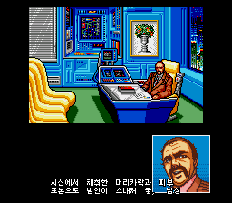
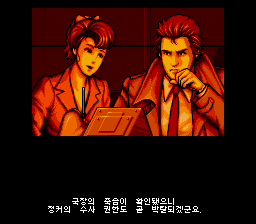
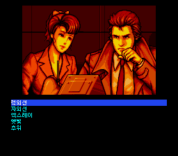

# 비공식 한글화 정식버전 V1.02 — ACT 전환 보이스 자막 수정

**ACT1을 마친 뒤 게임을 종료하지 않고 ACT2로 이어가면 한국어 보이스 자막이 나오지 않던 코어 오류를 수정했습니다.** 영어 음성은 재생되지만 한국어 자막이 사라지고, 완전히 재실행하면 정상으로 돌아오던 문제입니다.

> **V1.01 게임 사용자는 게임 BIN/CUE를 그대로 두고 전용 코어만 r62로 교체하세요. 게임 재패치는 필요 없습니다. 기존 r61 코어에는 이번 수정이 없습니다.** 보이스 자막에는 플랫폼에 맞는 전용 Genesis Plus GX 코어가 필수입니다.

## 변경 내용

- ACT2 회상의 CD 음성 자막을 선택할 때, 앞선 PCM 음성이 남긴 상태가 자막을 지워 버리던 우선순위 오류를 고쳤습니다. **실제 자막 표시 구간에서만** CD 음성에 우선권을 주고 지난 PCM 시계를 비웁니다. 이후 새 PCM 음성 자막도 계속 표시합니다.
- Windows x86_64 DLL, Android ARM64 SO, Linux x86_64 SO를 같은 **r62 소스**로 빌드했습니다. 소스980파일 중 자막 선택기 overlay1파일만 바꾸고 나머지979파일을 보존했습니다.
- **게임 BIN과 BPS는 V1.01과 바이트 동일**합니다. V1.01의 ACT1 통화·이동 복귀 정지 수정도 그대로 포함됩니다. 번역·선택문·음원·폰트·자막 그림·자막 시간표는 변경하지 않았습니다. V1.02 패처에서는 결과 게임 파일명만 `Snatcher-KR-v1.02`로 출력합니다.
- 흰 글씨·얇은 검은 테두리·하단 고정 위치와 음성을 따라가는 자막 방식을 유지합니다. 텍스트 바깥에 큰 검은 상자를 추가하지 않습니다.
- PS Vita는 [별도 r62 시험판 SELF](https://github.com/OldManCraveGuitars-bit/MegaCD-Snatcher-Kr/releases/tag/v1.02-vita-test1)를 제공합니다. **실제 비타 실행은 미확인**이며 Windows 패처에는 포함하지 않습니다.

## 업데이트 방법

**이미 V1.01 게임이 있는 경우**

1. RetroArch를 완전히 종료하고 기존 저장 파일을 백업합니다.
2. [V1.02 릴리스](https://github.com/OldManCraveGuitars-bit/MegaCD-Snatcher-Kr/releases/tag/v1.02)에서 사용하는 플랫폼의 코어를 받습니다.

   | 플랫폼 | 받을 파일 |
   | --- | --- |
   | Windows 64비트 | `genesis_plus_gx_snatcher_kr_libretro.dll` |
   | Android ARM64 | `genesis_plus_gx_snatcher_kr_libretro_android.so` |
   | Linux x86_64 | `genesis_plus_gx_snatcher_kr_libretro.so` |

3. 코어를 설치·교체하고 **새 r62 파일을 선택**합니다. 확장자가 같아도 Android SO와 Linux SO는 호환되지 않습니다. Android ARM32·Linux ARM용 빌드는 이번 자산에 없습니다.
4. RetroArch를 다시 실행하고 **기존 V1.01 CUE**를 엽니다. 게임 내 저장을 불러오세요. 게임 파일명은 그대로 두어도 됩니다. 옛 세이브스테이트의 호환성은 보증하지 않습니다.

**처음 설치하거나 V1.0 이하를 쓰는 경우**

1. `SnatcherKRInstaller.exe` 또는 `MegaCD-Snatcher-Kr-v1.02-Windows-Patcher.zip`을 받습니다.
2. **정확한 미국판 원본 BIN**을 선택해 존재하는 빈 폴더에 패치합니다. 이미 패치한 BIN에는 덧씌우지 않습니다. 약700MB 이상의 여유 공간이 필요합니다.
3. 출력된 `Snatcher-KR-v1.02.bin`과 `Snatcher-KR-v1.02.cue`를 같은 폴더에 보관하고, 플랫폼에 맞는 동봉 r62 코어를 선택한 뒤 **CUE**를 실행합니다.
4. Windows가 없으면 동봉 BPS를 원본 BIN에 수동 적용하고 결과 이름을 CUE에 맞추면 됩니다. BIOS는 사용자가 별도로 준비합니다. [자세한 패처 사용법](../README.md#패처-사용법)

패처는 게임 차분 패치와 코어3종·소스·명세·라이선스를 출력합니다. APK를 만들거나 RetroArch 본체를 수정하지 않습니다. Vita는 [별도 설치 안내](PS-VITA.md)를 사용하세요.

## 확인 범위

- **오류 상태 재현:** 실제 게임의 PCM 음성 종료 후 관측한 잔여 상태를 배포 C 자막 선택기와 실제 자막 데이터에 넣어 검사했습니다. 수정 전 ACT2 자막75쪽은 초기 상태300/300표시, 잔여 상태0/300표시였습니다. 300은75쪽×2바이트 순서×2PCM 재생 조건입니다.
- **수정 후 상태 전이 검사:** 초기/잔여 상태 각각300/300표시, ACT2 음성 트랙의 전체 섹터·표시 공백 대조에서 불일치0, 잘못된 CD 드라이브 상태 차단600/600을 확인했습니다. 다른 CD 음성13트랙·431쪽과 ACT2 CD 음성 뒤 새 PCM 음성으로 이어지는2바이트 순서 검사도 통과했습니다. 게임 RAM은 쓰지 않습니다.
- **ACT3 관련:** 다른 CD 음성에는 이미 잔여 PCM 상태를 해제하는 처리가 있어 같은 조건에서431쪽이 유지됩니다. ACT3 도입부도 Windows r62 코어로 정상 부팅·게임 내 저장을 불러와 연속 음성 자막, 음성 종료 후 소거, 약점 질문과 선택문으로의 입력 진행을 확인했습니다. ACT3 전편의 모든 분기나 ACT2 끝부터 ACT3까지 연속 플레이를 검증했다는 뜻은 아닙니다.
- **Windows 실제 실행:** 게임 RAM 주입·강제 장면 로드 없이 ACT2 회상 앞/뒤와 SP20→SP21, 이후 정상 접수처 메뉴와 입력을 확인했습니다. ACT3는 별도 native 저장으로 SP36 도입부부터 약점 선택문까지 확인했습니다. 제품 DLL을 별도 libretro 호스트에서 실행한 결과입니다. ACT1 끝부터 ACT2까지의 문제 조건은 위 C 선택기 상태 재현으로 확인했으며, 실제 전편 연속 플레이와 구분합니다.
- **플랫폼 빌드:** Android는 NDK r30·ELF64 AArch64·필수 함수9개, Linux는 Ubuntu24.04·ELF64 x86_64·동적 로드·libretro API1을 확인했습니다. 3개 코어에 같은 자막 은행33/33개가 들어 있습니다. [Linux 빌드 기록](https://github.com/OldManCraveGuitars-bit/MegaCD-Snatcher-Kr/actions/runs/43738773732)
- **최종 패처:** 실제 최종 EXE로 원본 전체를 패치한 출력11/11의 크기·SHA-256·CRC32 일치, 원본 불변 및 UI 시작 검사를 확인했습니다. 게임 결과는 V1.01과 같습니다.
- 제보자의 Linux 장치·Android/Vita 기기에서 게임을 실행한 결과는 아닙니다. 번역 전체 재검수·전편 재청취·모든 분기 재플레이를 이번 코어 수정 때문에 반복하지 않았습니다.

| ACT2 회상 자막 | ACT3 도입 자막 | ACT3 약점 선택문 |
| --- | --- | --- |
|  |  |  |

위 화면은 각각 게임 내 저장으로 부팅한 표본입니다. ACT 사이의 연속 전환을 촬영한 화면은 아닙니다.

## 입력·출력 및 코어 전후 해시

| 대상 | 크기(바이트) | SHA-256 | CRC32 |
| --- | ---: | --- | --- |
| 입력 원본 BIN | 625,192,176 | `8d6f4dba8d9ce59991be9f65635047adc3b0f37ea2358f8c48b251883c9e55b6` | `3faf807d` |
| 출력 V1.02 BIN (= V1.01) | 625,192,176 | `dd91fc991ab5e7feb0c965cc15e001d9c0ff6dc24e7b504293b51dec6447381f` | `538234e4` |
| BPS (= V1.01) | 1,123,790 | `068be41b5084c7ab883e305cdd921019db17ab5f51c4f90d9a8d5677da319c4d` | `2144df1c` |
| V1.02 CUE | 1,363 | `0958290a90c790559bba8aeed053d136efe0415174e26f7ff8bb07af3418e899` | `d1736702` |
| V1.02 EXE | 34,827,576 | `252a11d670eb60832fad834056eacdc9d49b8ab95f4d3f4d16bffe6b3e93b6f7` | `a4bbd1b6` |
| 이전 Windows r61 DLL | 6,234,472 | `6f59a1d4ec2665d4414a9bb8d90ed88a1c0d5f55c2d463df31e7ca08cccb0c21` | `7ceeb056` |
| 새 Windows r62 DLL | 6,234,472 | `15c3b12ba2ab814b05a5a27bcc4fe0d8d3062aca011ed816f6c526921e6ad35c` | `42619156` |
| 이전 Android r61 SO | 9,072,608 | `8f3ac404f9b9f93092a86b4d7d56fcccd62fbef028bba45a56c3b9f43c3d67c2` | `52cd9cd1` |
| 새 Android r62 SO | 9,072,608 | `37a0b3363593b74c5176b5f22095160c2db839a168b6f815f476deb8c987d088` | `15d1cc6a` |
| 이전 Linux r61 SO | 9,128,112 | `3d40e61077510ae616211ff37058df4625d23e701e4b301ebb643cd70272c80b` | `05d5d78c` |
| 새 Linux r62 SO | 9,128,112 | `0e313f07b4b9a1d08af98e9675ebeb5a786875bb5caa0b1b8815a7e17adb29d9` | `8fe92f82` |

파일명이 바뀌어도 게임 BIN/BPS의 내용은 V1.01과 동일합니다. CUE는 참조하는 BIN 파일명 변경 때문에 해시가 다릅니다. **용량이 같아도 코어 내용은 달라졌으므로 해시로 r62를 확인하세요.**

전체14개 배포 파일의 해시는 [SHA256SUMS-v1.02.txt](../SHA256SUMS-v1.02.txt)에 있습니다. [완전한 r62 소스](../core-source/modified-core-source.zip)의 SHA-256은 `58b49adcbb6bfe9bd3595e42866968053ccd7f9755d31bbae1588fc722c95741`입니다. `CORE-BUILD.json`에980개 소스 파일과 각 플랫폼 빌드가 기록됩니다.

[DS-Snatcher-Kr-MegaCD-Porting](https://github.com/OldManCraveGuitars-bit/DS-Snatcher-Kr-MegaCD-Porting): Nintendo DS용 비공식 포팅 프로젝트도 있습니다.

원본/완성 게임 이미지·BIOS·APK는 포함하지 않습니다. Konami, Sega, Libretro와 제휴하지 않은 비공식·비상업적 팬 프로젝트입니다.
